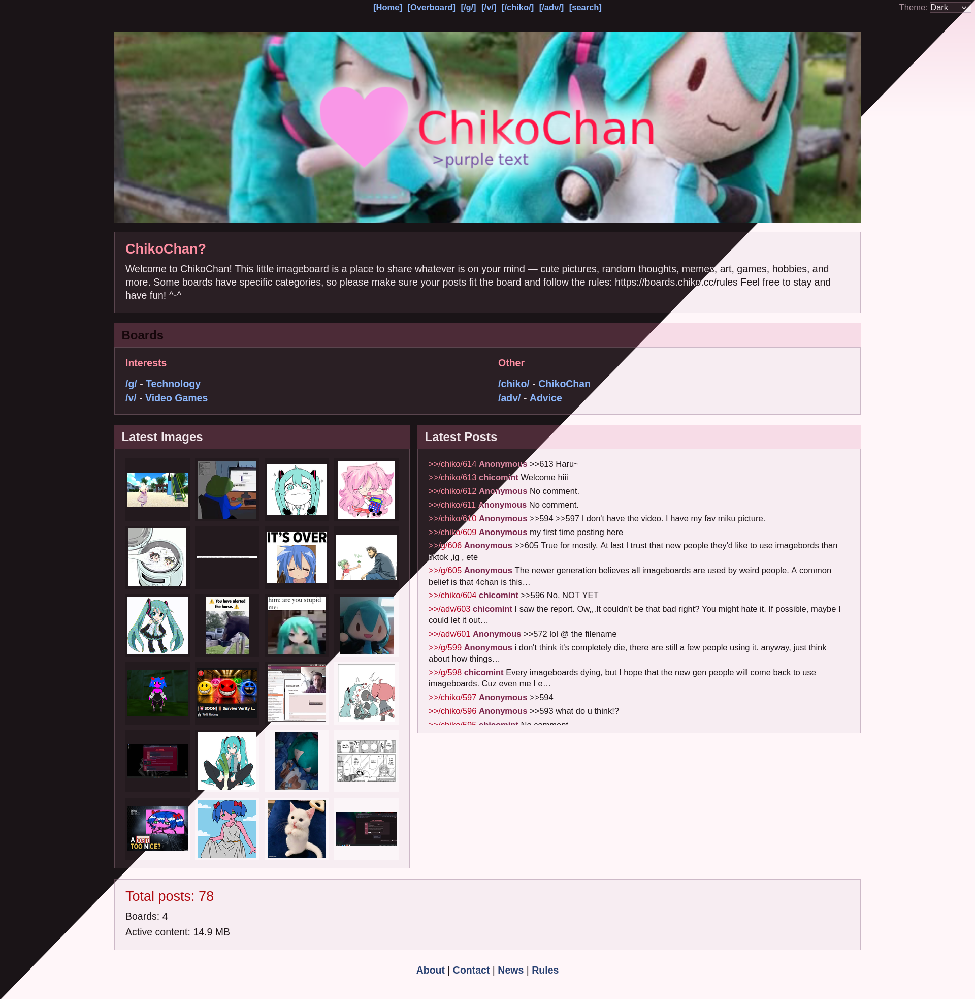

#  ChikoChan



A lightweight and simple imageboard built with Node.js.
ChikoChan supports multiple boards, file uploads, and can run locally without needing a database server.

## Getting Started

### Requirements

- Node.js 22 or newer
- npm
- Git

### Installation

Clone the repository:

```bash
git clone https://github.com/chicomint/ChikoChan.git
cd ChikoChan
```

Install the dependencies:

```bash
npm install
```

Start ChikoChan:

```bash
npm start
```

Then open:

```text
http://localhost:3000
```
Follow the setup on the page. The configuration will be saved in a `.env` file. If you want to change or add more settings later, check `env.example.txt` for the available options.


(To skip the installer for local testing, you can still use):

```bash
npm run start:local
```


## Development

Start the server with Node.js watch mode:

```bash
npm run dev
```

Run tests:

```bash
npm test
```

Check the JavaScript files for syntax errors:

```bash
npm run check
```


## Browser support

Board browsing, posting, multipart uploads, quoting, catalogs, search, reporting, deletion, and staff moderation use HTML links and forms. Posting verification uses a first-party image challenge in either browser mode. The challenge requires cookies and a visual answer. Staff can use the layout and article forms from the editor pages when scripting is disabled.

To run the browser regression suite, provide an installed Playwright module and Chromium. The suite uses disposable local boards and requires FFmpeg and FFprobe for its video fixture.

```bash
node scripts/verify-no-js-browser.js /path/to/playwright /path/to/chromium
node scripts/verify-maintenance-mongo.js /path/to/mongodb-memory-server
```

## IP retention and upgrades

The application does not use visitor IPs for posts, reports, authorization, or rate limiting. Anonymous limits are shared by operation. Existing staff accounts remain the basis for staff quotas. Upload-hash sanctions and password-authorized deletion are available.

Stop old application instances before starting this version against an existing database. Schema 19 removes legacy address metadata and derived poster and reporter keys, removes identity-based sanctions and associated appeals, and cleans old MongoDB rate-limit buckets. The configured Redis adapter removes the old rate-limit namespace for its prefix. Local backup, restore, and JSON-to-MongoDB migration sanitize the post database they write.

Existing exports, archived logs, provider snapshots, and database replication history need separate retention review. Restore older snapshots to an isolated database and run the migration before routing requests to them. Unchanged installations and copies held by previous hosts need their own cleanup.

Railway HTTP request logs include the client source IP. App logging controls and Railway tracing settings do not govern those edge logs. Deployment-wide zero optional retention requires a verified ingress and provider retention policy. [Railway logs documentation](https://docs.railway.com/observability/logs)
